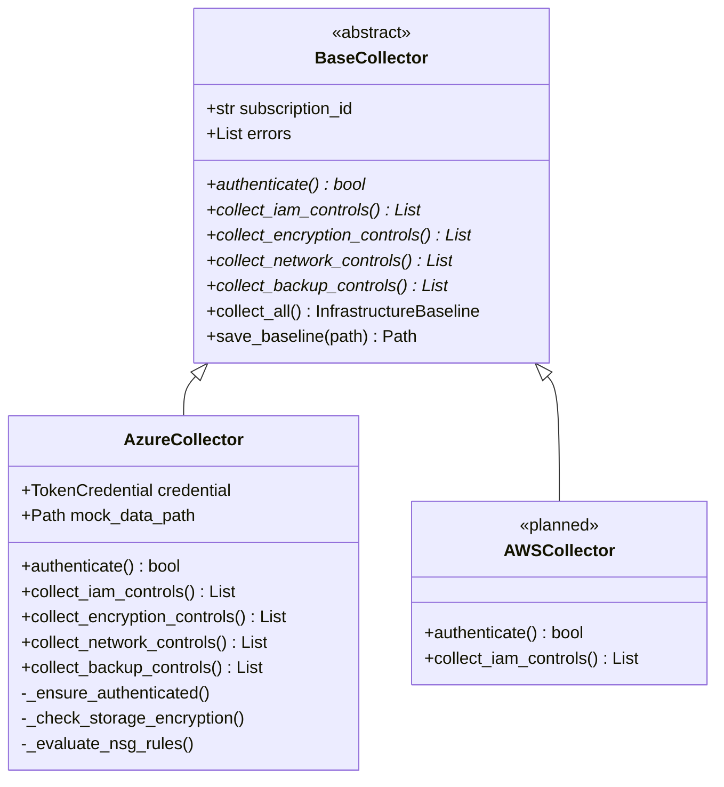

# System Architecture: Technical Baseline Collection & OSCAL Normalization

> **Academic Research Context**: Policy-as-Code & Automated Compliance Framework  
> **Author**: Ritvik Bahirwar (Master's in Computer Engineering for IoT Systems)  
> **Target Reviewers**: Max Planck Institute for Security and Privacy (MPI-SP)  
> **Lifecycle Phase**: Step 2 — Technical Control Baseline Definition

---

## 1. Architectural Philosophy & Design Principles

The primary objective of Step 2 is to solve a fundamental dilemma in automated governance:
**How do we capture the dynamic, heterogeneous "As-Is" operational state of enterprise cloud infrastructure and normalize it into an interoperable, vendor-neutral schema (NIST OSCAL Component-Definition) suitable for automated gap analysis against normative legal statutes (GDPR, DORA, NIS2)?**

To ensure high maintainability, academic reproducibility, and enterprise extensibility, this architecture adheres to four foundational engineering principles:

1. **Strategy Pattern for Multi-Cloud Extensibility**: Decouples cloud-specific API telemetry (Azure ARM SDK, AWS Boto3, GCP Cloud Client) from the uniform compliance evaluation interface.
2. **Type Safety via Pydantic v2**: Enforces schema validation at runtime, preventing malformed cloud API responses from propagating into downstream analysis engines.
3. **Open Standards Interoperability (NIST OSCAL v1.1.2)**: Uses the NIST Open Security Controls Assessment Language (OSCAL) Component-Definition schema rather than proprietary JSON schemas, preventing vendor lock-in.
4. **Air-Gapped & Zero-Credential Reproducibility**: Enables deterministic evaluation via local mock telemetry (`data/mock_cloud_responses/`), eliminating dependencies on live cloud accounts during academic peer review.

---

## 2. End-to-End Data Pipeline Architecture

```text
┌─────────────────────────────────────────────────────────────────────────────┐
│                          Enterprise Cloud Infrastructure                    │
│    Microsoft Azure (ARM)     │     Amazon Web Services     │  Google Cloud  │
│   (Storage, VMs, NSGs, KV)   │     (S3, EC2, Security Grp) │  (GCS, Compute)│
└──────────────────────────────────────┬──────────────────────────────────────┘
                                       │
                                       ▼
┌─────────────────────────────────────────────────────────────────────────────┐
│                    Cloud Collector Layer (Strategy Pattern)                 │
│                                                                             │
│                        ┌─────────────────────────┐                          │
│                        │   BaseCollector (ABC)   │                          │
│                        └────────────┬────────────┘                          │
│                                     │                                       │
│          ┌──────────────────────────┼──────────────────────────┐            │
│          ▼                          ▼                          ▼            │
│   AzureCollector              AWSCollector (WIP)        GCPCollector (Plan) │
│   - IAM Controls              - IAM Policies            - IAM Roles         │
│   - Encryption At-Rest/Transit- KMS Encryption          - CMEK Encryption   │
│   - NSG Ingress/Egress Rules  - Security Group Rules    - VPC Firewall Rules│
│   - Backup & Redundancy       - Backup Retention        - Backup Vaults     │
└──────────────────────────────────────┬──────────────────────────────────────┘
                                       │
                                       ▼ (InfrastructureBaseline)
┌─────────────────────────────────────────────────────────────────────────────┐
│                    Pydantic v2 Data Modeling & Validation                   │
│   - TechnicalControl: Normalized control attributes, state, & status       │
│   - InfrastructureBaseline: Snapshot metadata, timestamps, & telemetry      │
└──────────────────────────────────────┬──────────────────────────────────────┘
                                       │
                                       ▼
┌─────────────────────────────────────────────────────────────────────────────┐
│                  NIST OSCAL Component-Definition Normalizer                 │
│   - Deduplicates controls into resource-centric OSCAL components            │
│   - Synthesizes weakest-link compliance status across control categories   │
│   - Generates RFC 4122 UUIDs and ISO 8601 UTC audit timestamps              │
└──────────────────────────────────────┬──────────────────────────────────────┘
                                       │
                     ┌─────────────────┴─────────────────┐
                     ▼                                   ▼
        ┌─────────────────────────┐         ┌─────────────────────────┐
        │   Standard JSON Output  │         │ NIST OSCAL Component-Def│
        │ baselines/azure.json    │         │ baselines/oscal.json    │
        └─────────────────────────┘         └─────────────────────────┘
```

---

## 3. Core Architectural Components

### 3.1 Data Models (`src/models/technical_control.py`)
All infrastructure configurations are strictly typed using Pydantic v2 models:

- `CloudProvider`: Enum specifying the cloud ecosystem (`azure`, `aws`, `gcp`).
- `ControlCategory`: Functional domains derived from European regulations:
  - `identity_access_management` (GDPR Art. 32(1)(b), NIS2 Art. 21(2)(i))
  - `data_encryption` (GDPR Art. 32(1)(a), DORA Art. 6(1))
  - `network_security` (NIS2 Art. 21(2)(e), DORA Art. 6(2))
  - `backup_recovery` (DORA Art. 11(1), GDPR Art. 32(1)(c))
- `ComplianceStatus`: Tri-state assessment outcome (`COMPLIANT`, `NON_COMPLIANT`, `PARTIAL`, `UNKNOWN`).
- `TechnicalControl`: Atomic observation of an infrastructure asset containing:
  - `control_id`: Deterministic identifier (e.g., `azure-storage-encryption-stprod`).
  - `resource_id`: Fully qualified Cloud Resource ID / ARN.
  - `current_state`: Raw key-value dictionary of extracted API properties.
  - `compliance_status`: Binary/tri-state evaluation against technical baselines.
- `InfrastructureBaseline`: Aggregated snapshot container tracking total resources scanned, collection timestamp, metadata, and error telemetry.

### 3.2 Multi-Cloud Strategy Pattern (`src/collectors/`)
The collection subsystem decouples cloud provider nuances using the Gang of Four (GoF) Strategy Pattern:



#### Exception Isolation Strategy
In enterprise environments, scanning accounts may lack broad permissions across all services. `BaseCollector.collect_all()` executes each category within an isolated `try/except` boundary. If an API call fails with `403 Forbidden` or `AzureError`:
1. The error is appended to `self.errors`.
2. A non-fatal alert is logged.
3. The remaining categories continue execution uninterrupted.

### 3.3 NIST OSCAL Normalizer (`src/normalizers/oscal_component_normalizer.py`)
Converts raw baselines into standardized NIST OSCAL Component-Definitions (`component-definition` root):

1. **Resource Deduplication**: Multiple atomic controls discovered on a single cloud resource (e.g., encryption-at-rest + HTTPS enforcement on a Storage Account) are aggregated into a single OSCAL `component`.
2. **Weakest-Link Status Evaluation**: If any atomic control on a component fails, the component's overall status rolls up to `NON_COMPLIANT`.
3. **Cross-Step Interoperability**: OSCAL components directly align with Step 1's `oscal_catalog_schema.json`, preparing the framework for Step 3's semantic cross-comparison.

### 3.4 CLI Baseline Orchestrator (`src/main_baseline.py`)
Provides an interactive command-line interface powered by `rich`:
- Color-coded summary tables displaying baseline metrics, category counts, and compliance percentages.
- Safe console UTF-8 fallback for cross-platform compatibility across Windows PowerShell, Linux, and macOS.
- Flags for target subscription, region filtering, mock data execution, and JSON/OSCAL dual export.

---

## 4. Socio-Technical Friction & Engineering Trade-Offs

| Decision | Trade-Off | Rationale |
| :--- | :--- | :--- |
| **Pydantic v2 over Dicts** | Minor runtime validation overhead | Type safety, field-level sanitization, and deterministic serialization prevent silent bugs. |
| **Strategy Pattern vs Ad-Hoc Scripts** | Modest interface boilerplate | Critical for expanding from Azure to AWS/GCP without altering downstream OSCAL normalizers. |
| **NIST OSCAL over Custom JSON** | Verbose schema structure | Enables global standard compliance and interoperability with FedRAMP, OpenShift, and enterprise GRC tooling. |
| **Mock Cloud Responses** | Requires updating mock fixtures when APIs evolve | Guarantees academic peer reviewers can run the pipeline without incurring cloud subscription costs or credential setup. |
